<p align="center">
  <picture>
    <source media="(prefers-color-scheme: dark)" srcset="branding/muesca-wordmark-dark.png">
    <source media="(prefers-color-scheme: light)" srcset="branding/muesca-wordmark.png">
    
  </picture>
</p>

<h3 align="center">El notch para Claude Code, en Windows.</h3>

<p align="center">
  Tu <strong>cuota real de 5 h / 7 d</strong>, tus <strong>sesiones de Claude Code</strong> y sus <strong>peticiones de
  permiso</strong> en un notch arriba de la pantalla. Sin cambiar de ventana.
</p>

<p align="center">
  <a href="https://github.com/Yovancas/muesca/releases/latest"></a>
  &nbsp;
  
</p>

<p align="center">
  <a href="https://github.com/Yovancas/muesca/actions/workflows/ci.yml"></a>
  <a href="https://github.com/Yovancas/muesca/releases/latest"></a>
  <a href="https://github.com/Yovancas/muesca/releases"></a>
  <a href="LICENSE"></a>
  
</p>

<p align="center"><em><a href="README.md">Read in English</a></em></p>

<p align="center">
  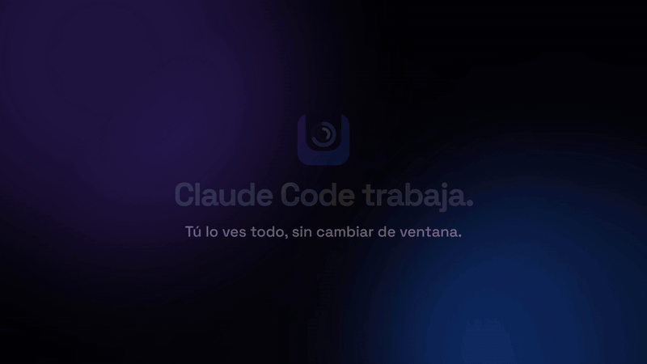
</p>

<p align="center"><a href="https://github.com/Yovancas/muesca/releases/latest/download/muesca-es-16x9.mp4"><strong>▶ Ver el vídeo de 35 segundos</strong></a></p>

<p align="center"><sub><strong>No afiliado a Anthropic. Claude es una marca de Anthropic.</strong> Muesca solo lee la cuota que tu
propia sesión de Claude Code ya tiene.</sub></p>

## Por qué Muesca

- **Sabes cómo vas de un vistazo.** Dos anillos arriba de la pantalla: tu cuota real de 5 horas y de 7 días, las mismas
  cifras que respeta Claude Code. Se acabó toparte con el límite por sorpresa.
- **Contestas a Claude sin dejar lo que haces.** Cuando Claude Code pide un permiso, el notch lo enseña con
  **Permitir / Denegar**. Cuando termina, te avisa.
- **Todas tus sesiones en un sitio.** Quién trabaja, quién espera tu turno y, con un clic, a su terminal.
- **Ligera y privada.** ~0 % de CPU en reposo, sin cuenta, y nada sobre ti sale de tu equipo.

## Empieza en 1 minuto

1. **Descarga** el instalador de la [última release](https://github.com/Yovancas/muesca/releases/latest) y ábrelo
   (por usuario, sin administrador y sin instalar .NET).
2. El notch baja desde arriba con una **bienvenida corta**: eliges un perfil y qué activar.
3. Abre **Claude Code** como siempre. El notch se rellena solo. ¿Quieres el recorrido completo? *Menú del icono ›
   Tutorial*.

<details>
<summary><strong>Índice</strong></summary>

- [¿Qué es Muesca?](#qué-es-muesca)
- [Funciones](#funciones)
- [Cómo funcionan los datos](#cómo-funcionan-los-datos)
- [Instalación](#instalación) · [Requisitos](#requisitos) · [Configuración](#configuración)
- [Sesiones en vivo y hooks](#sesiones-en-vivo-y-hooks)
- [Compilar desde el código](#compilar-desde-el-código)
- [Desinstalar](#desinstalar) · [Notas y preguntas frecuentes](#notas-y-preguntas-frecuentes)

</details>

> **Muesca es el nuevo nombre de ClaudeBar for Windows.** Es la misma app: tu configuración, tus tareas, tu historial y
> tus hooks de Claude Code siguen donde estaban y no tienes que hacer nada. Por qué: «Claude» es una marca de Anthropic y
> el producto no puede llamarse así. Los detalles, en [docs/branding.md](docs/branding.md).

---

## ¿Qué es Muesca?

Un notch negro cuelga del borde de arriba de la pantalla, como el de un móvil. En reposo enseña dos anillos: tu cuota de
Claude de **5 horas** y de **7 días**, los **porcentajes reales** que Anthropic le devuelve al propio Claude Code. Pasa el
ratón y se abre: tu cuota con su reinicio y, al lado, **todas las sesiones de Claude Code abiertas** y lo que hace cada
una. Cuando Claude te necesita (un permiso, tu turno para escribir, una tarea terminada, una cuota a punto de acabarse)
el notch te avisa, y puedes **permitir o denegar un permiso sin ir a la terminal**.

Con la rueda, el notch tiene más páginas: **música con letras sincronizadas**, **tareas con recordatorios**, una
**bandeja de archivos**, **gráficas de uso** y un **pomodoro**. Junto al reloj, el **icono de la bandeja** conserva el
panel de siempre: barras de cuota, ritmo, gasto estimado por modelo e historial.

Dos números, dos verdades, y Muesca no las mezcla:

- **El % de cuota (5 h / 7 d) es REAL**: la cifra exacta que Anthropic le devuelve a Claude Code.
- **El gasto en $ es una ESTIMACIÓN**: el coste equivalente de la API calculado en local con tus transcripts. **No** es
  lo que pagas por la suscripción.

Está hecho en **C# / .NET 9 + WinForms**, todo pintado con GDI+ (nítido a cualquier DPI), y gasta **~0 % de CPU en
reposo**.

---

## Funciones

<sub>Las capturas usan los datos de ejemplo del tutorial: nunca la cuota real de nadie.</sub>

### El notch

<p align="center">
  
  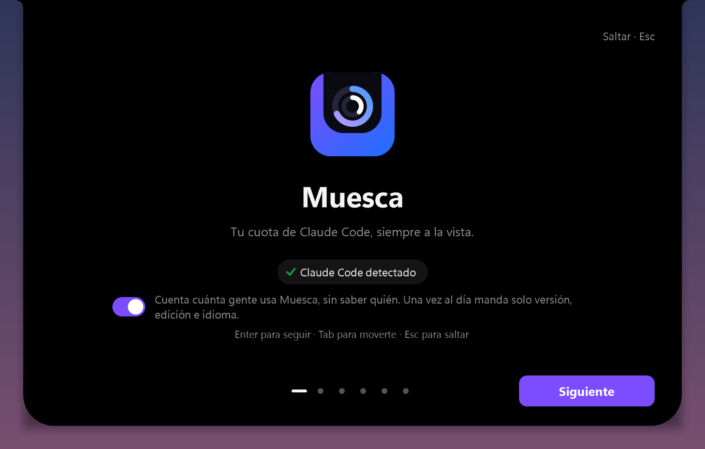
</p>

- **En reposo, dos anillos**: la cuota de 5 h y de 7 d. Pasa el ratón y se abre (o solo con clic, si lo prefieres).
- **Una cara para cada momento**: *trabajando* (spinner, proyecto, herramienta y tu %), *listo* (un aviso verde y, si
  quieres, un sonido), *cuota alta* (aviso al 80 %, en rojo con halo al 95 %), una **raya fina** mínima, o el **reloj con
  un gato** que sigue el puntero con la mirada cuando todo está en calma.
- **No molesta**: se esconde en juegos y vídeos a pantalla completa, nunca roba el foco y respeta *Reducir movimiento*.
- **Páginas**: la rueda, los puntos o las flechas ‹ › pasan entre Claude, Uso, Música, Tareas, Foco y Bandeja.
- **Bienvenida dentro del notch**: la primera vez, el notch baja y se despliega en una configuración breve (perfiles con
  vista previa en vivo, qué se activa, ajustes recomendados, Claude Code) que puedes repetir desde la bandeja.

### Sesiones

- A la derecha del notch abierto, **todas las sesiones de Claude Code abiertas**: proyecto, qué hace y desde cuándo.
- **Trabajando · tu turno · en reposo**: gira mientras Claude trabaja, *tu turno* cuando espera que escribas.
- **Un clic en una sesión trae su terminal al frente.**
- Opcional: instala hooks en `~/.claude/settings.json` con copia de seguridad antes (ver [Sesiones en vivo y hooks](#sesiones-en-vivo-y-hooks)).

### Permisos <sub>Pro</sub>

<p align="center">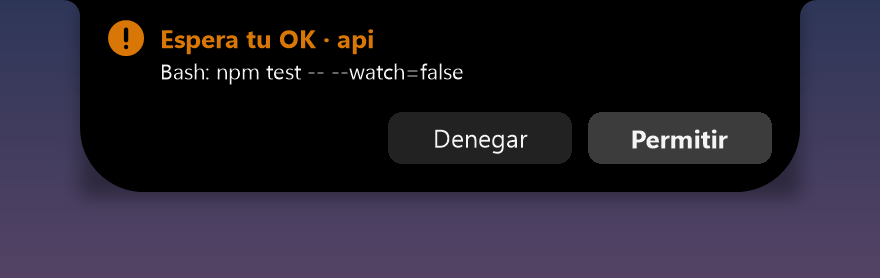</p>

- Cuando Claude Code pide permiso (ejecutar un comando, editar un archivo…), el notch lo enseña con **Denegar /
  Permitir**.
- Los botones **se arman antes** (se rellenan y no responden hasta entonces): nunca apruebas algo que no has leído.
- **Nada se decide sin tu clic**: si Muesca está cerrada, ocupada o no contestas en 25 s, Claude Code pregunta en su
  terminal como siempre.

### Música y letras <sub>Pro</sub>

<p align="center">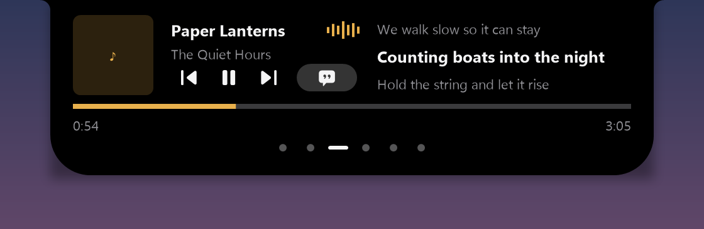</p>

- Lo que suena en Windows (Spotify, el navegador…) con su portada: pausa, anterior/siguiente, saltar a un punto.
- **Letras sincronizadas** línea a línea (de [lrclib.net](https://lrclib.net)), y la línea que suena en el notch cerrado.

### Tareas y recordatorios <sub>Pro</sub>

<p align="center">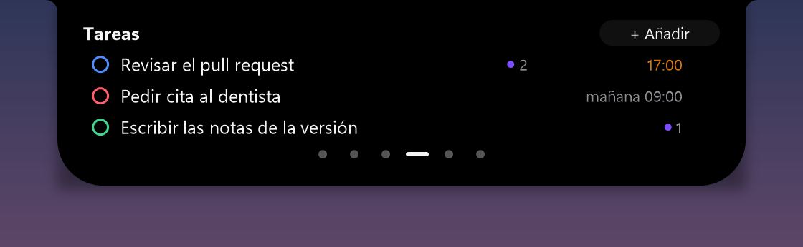</p>

- Una lista corta en el notch: título, color y cuándo avisarte (15 min, 1 h, mañana a las 9 o a tu hora).
- A su hora, un aviso con **Hecha** y **+10 min**.

### Bandeja de archivos <sub>Pro</sub>

<p align="center">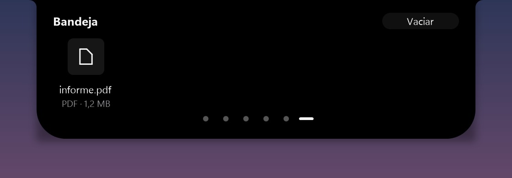</p>

- Suelta un archivo, un enlace o un texto sobre el notch y se queda en la bandeja. Un clic lo abre; arrástralo fuera
  para soltarlo en otra app.

### Uso

<p align="center">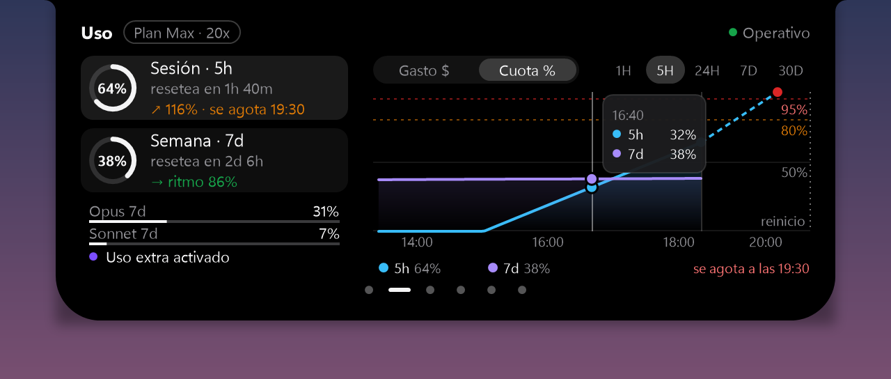</p>

- El gasto de hoy, tu cuota y tu ritmo, con una gráfica de **gasto por modelo** o de **% de cuota**.
- Clic en la tarjeta de 5 h o de 7 d y la gráfica enseña esa ventana. Con Pro: tooltips, rangos de 1H a 30D y hacia
  dónde va tu ritmo.

### Foco (pomodoro)

<p align="center">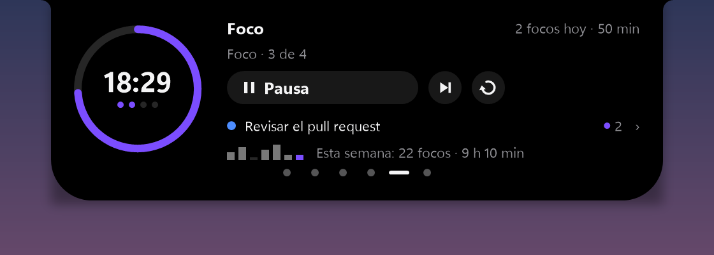</p>

- 25 min de foco y un descanso (uno largo cada 4). Empezar, pausar, saltar, reiniciar.
- Cerrado, un **mini anillo** enseña lo que queda. Al acabar una fase, un aviso ofrece la siguiente.
- Con Pro: enlaza el foco con una tarea y mira tu semana.

### El tutorial

<p align="center">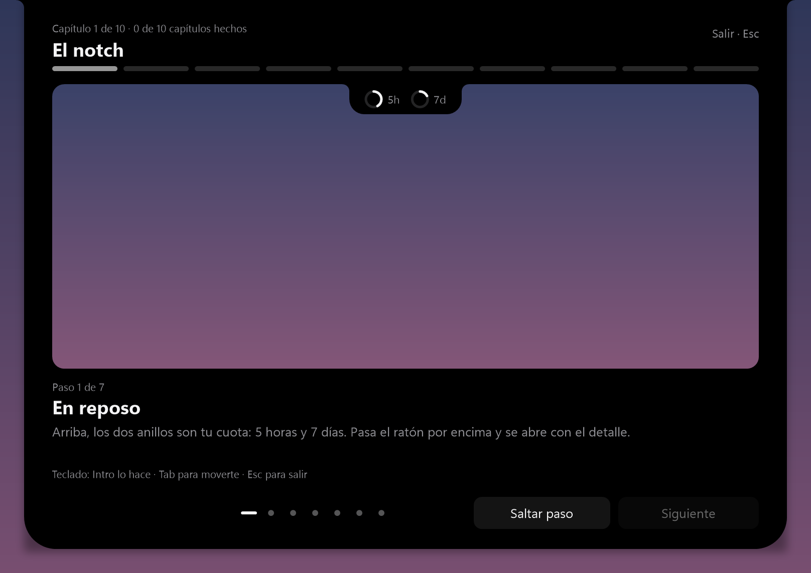</p>

- Diez capítulos cortos con un **notch de demostración** que usas de verdad: pasar el ratón, hacer clic, arrastrar. Solo
  datos de ejemplo; nada se manda a Claude. Ábrelo al final de la bienvenida, desde el menú de la bandeja o desde
  *Ajustes › Acerca de*.

### Icono de la bandeja y panel

<p align="center">
  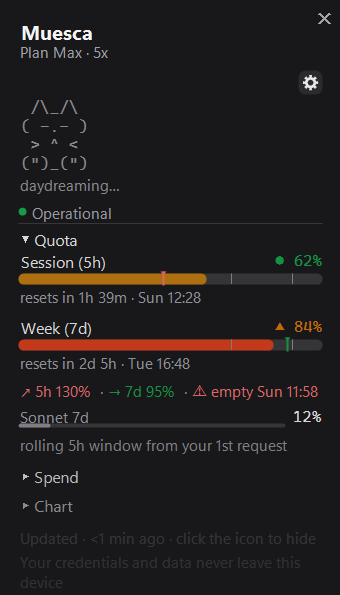
  
</p>

- **El icono junto al reloj** enseña la mayor de tus dos ventanas, de verde a ámbar y a rojo, con formas para
  daltónicos (**triángulo** = aviso, **rombo** = crítico), texto con contraste automático y un punto ámbar cuando una
  sesión te necesita.
- **El panel** (clic en el icono): barras de 5 h y 7 d por % real, **ritmo con la hora estimada de agotarse en cada
  ventana**, **gasto estimado por modelo** (cada familia que aparezca en tus datos, con precios de
  [models.dev](https://models.dev)), una gráfica de gasto o de cuota de 1H a 30D, el estado del servicio y el gato de las
  sesiones en vivo.
- **Avisos**: hitos (25 / 50 / 75 / 95 %), avisos de ritmo y de las sesiones en vivo.
- **Temas** Sistema / Oscuro / Claro / CLI (y paletas `.itermcolors`), opacidad, fijado y siempre encima.
- **8 idiomas**: English, Español, Nederlands, Français, Deutsch, 日本語, 한국어, 繁體中文.

### Gratis y Pro

| | Gratis | Pro |
|---|:---:|:---:|
| Icono de la bandeja, panel, gráficas, avisos, temas, idiomas | ✓ | ✓ |
| Notch: anillos de cuota, avisos de cuota, estado de las sesiones, Uso, Foco, tutorial | ✓ (monitor principal) | ✓ |
| Permitir / Denegar desde el notch | | ✓ |
| Música y letras sincronizadas | | ✓ |
| Tareas con recordatorios | | ✓ |
| Bandeja de archivos | | ✓ |
| Notch en todos los monitores | | ✓ |
| Gráficas de uso (tooltips, rangos, proyección) y pomodoro avanzado | | ✓ |

- **El Pro es un pago único** y se vende en la edición de la **Microsoft Store** (con **7 días de prueba**). La edición de
  GitHub / winget es gratis y enseña lo Pro con un chip *Pro* discreto y un botón a la Store.
- Sin Pro no se rompe nada: las tareas y la bandeja conservan sus datos, y los permisos van al diálogo de siempre de
  Claude Code.

---

## Cómo funcionan los datos

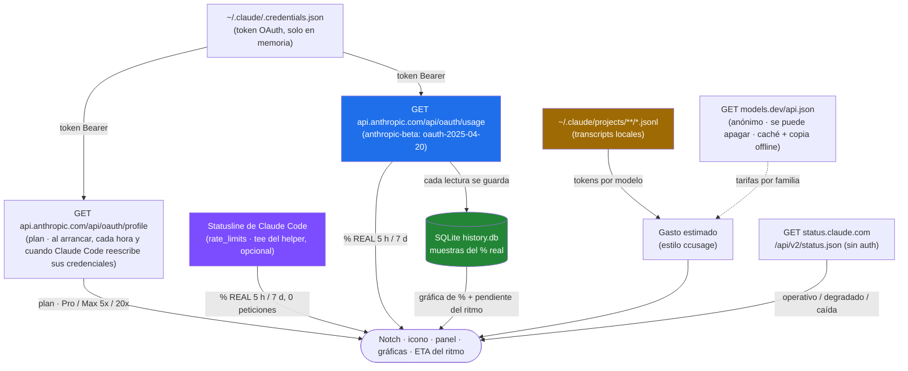

1. **Cuota desde Claude Code, cero peticiones a la API (opcional).** Claude Code ya le pasa a su statusline tu uso de
   `five_hour` / `seven_day` (Pro/Max, Claude Code ≥ 2.1.80). Con **Ajustes → Origen de la cuota → Leer la cuota desde
   Claude Code**, Muesca pone un pequeño tee nativo (`claudebar-helper.exe`) delante de tu statusline en
   `~/.claude/settings.json`:

   ```
   <helper> statusline --tee | ccstatusline      # tu statusline sigue recibiendo el mismo JSON
   ```

   Va escrito para que aguante que falte el helper: si `<helper>` no está (por ejemplo, porque se desinstaló Muesca sin
   apagarlo), tu statusline recibe el JSON directamente y sigue funcionando. En Git Bash queda
   `if [ -e <helper> ]; then <helper> statusline --tee; else cat; fi | ccstatusline`; en PowerShell, lo mismo con
   `Test-Path`.

   El helper guarda una instantánea pequeña por sesión en `%LOCALAPPDATA%\ClaudeBarWin\ratelimits\` y Muesca la recoge
   un segundo después de cada respuesta de Claude. ¿Sin statusline? Muesca pone una compacta (`5h 23% | 7d 41%`).
   Desactivarlo restaura tu statusline **tal cual**; siempre se hace copia de `settings.json` antes. Las statuslines
   compuestas (`a && b`, `a; b`) no se tocan.
2. **Cuota desde la API (activada por defecto, no oficial).** Con **Leer la cuota con tu sesión de Claude Code (no
   oficial)**, `GET https://api.anthropic.com/api/oauth/usage` con tu token OAuth local (ver
   [Privacidad y datos](#privacidad-y-datos)) devuelve `five_hour` / `seven_day` (y Opus / Sonnet) con `utilization` y
   `resets_at`: los **mismos límites que respeta Claude Code**. Mientras una sesión alimenta la statusline, a la API se
   le pregunta como mucho cada 15 minutos. Ante un `429` espera (5 → 10 → 20 … ≤ 60 min, respetando `Retry-After`) y
   enseña el último valor bueno.
3. **Historial del % real.** Cada lectura se guarda en SQLite (`%APPDATA%\ClaudeBarWin\history.db`, como mucho una vez
   por minuto, se poda a los 40 días). Alimenta la gráfica *Cuota %* y la estimación del ritmo, así que **empieza vacío y
   se va llenando**.
4. **Ritmo + ETA.** Ritmo = % usado frente al ideal para lo que va de ventana. La ETA extrapola la pendiente reciente,
   sin contar los reinicios.
5. **Token caducado: Muesca nunca lo reescribe.** Muesca **nunca escribe** `~/.claude/.credentials.json`: Claude Code lo
   mantiene al día y Muesca lo vuelve a leer cuando cambia. Solo si activas **Forzar renovación con la CLI (gasta un
   mensaje)**, apagado por defecto, ejecuta `claude -p .` (como mucho una vez cada 30 minutos).
6. **Estado del servicio.** `GET status.claude.com/api/v2/status.json` (público, sin auth), en caché ~2 min.
7. **Gasto estimado.** Tus transcripts `.jsonl` locales (el método de `ccusage`) con las **tarifas públicas de
   [models.dev](https://models.dev)**: en caché en `%APPDATA%\ClaudeBarWin\models-pricing.json`, con una **copia
   offline embebida**, y el interruptor opcional **Actualizar tarifas online** es lo único que toca models.dev (un GET
   anónimo). Un modelo sin tarifa conocida sale como `— sin tarifa` y no suma al total. Es una **estimación equivalente
   de la API, no tu factura**.

### Privacidad y datos

- **Qué lee.** De `~/.claude/.credentials.json`, solo `claudeAiOauth.accessToken` y `expiresAt` (y los no secretos
  `subscriptionType` / `rateLimitTier` como respaldo del plan), justo antes de cada petición. El `refreshToken` nunca se
  lee, y los bytes se ponen a cero después.
- **Adónde va.** Solo a `https://api.anthropic.com/api/oauth/usage` y `/api/oauth/profile`: HTTPS por el puerto 443, el
  host se comprueba antes de enviar y en la respuesta, **nunca sigue redirecciones**, 10 s de timeout, respuesta de 64 KB
  como mucho, tu proxy del sistema y un User-Agent honesto `ClaudeBarWin/<versión>` (nunca se hace pasar por Claude
  Code).
- **Qué guarda.** Nada: el token vive en memoria durante una petición, nunca se escribe en la config, cachés, logs ni
  volcados, y se imprime como `Creds(***)`.
- **El archivo en claro es de Claude Code.** Muesca no lo cifra, ni puede ni debe (Claude Code ya no podría leerlo), y
  nunca lo escribe ni lo copia.
- **No oficial.** Anthropic no documenta estos endpoints para terceros: pueden cambiar sin aviso.
- **Con el ajuste apagado**, Muesca nunca abre `.credentials.json` ni llama a esos endpoints: la cuota sale solo de la
  statusline.
- **Contador anónimo de uso** (activado por defecto, se apaga con un interruptor): como mucho una vez al día, exactamente
  `{"v":"1.0.0","e":"free","l":"es","d":1,"m":1,"n":0}` (versión, edición, idioma y tres casillas 0/1). **Ningún
  identificador**; el servidor solo suma casillas por día, no guarda IPs ni registros. Apágalo en **Ajustes › Sistema**,
  en la bienvenida o con `CLAUDEBAR_NO_STATS=1`. Detalles: [PRIVACY.es.md](PRIVACY.es.md).
- **Nada tuyo sale de tu equipo**: ni credenciales, ni transcripts, ni prompts, ni cifras de uso. Las únicas conexiones
  son las de esta sección y las letras de lrclib.net cuando la página de música las busca.

Política de seguridad y modelo de amenazas: [SECURITY.md](SECURITY.md).

---

## Instalación

### Descarga el instalador (recomendado)

Descarga el instalador (`ClaudeBar-win-Setup.exe`: Velopack lo nombra con el id interno del paquete) de la
**[última release](https://github.com/Yovancas/muesca/releases/latest)** y ejecútalo.

- **Por usuario, sin admin**, **autocontenido (sin instalar .NET)**, se instala en 2-3 s con una pantalla de carga.
  *Muesca* aparece en el menú Inicio y en *Aplicaciones*.
- **Las actualizaciones se instalan solas**: se descargan en segundo plano con parches delta y se aplican al reiniciar
  Muesca desde el menú de la bandeja (o al cerrarla). Cada release lleva un **manifiesto firmado con Ed25519**; lo que no
  esté firmado con la clave de Muesca se ignora.
- ¿Vienes de **ClaudeBar 0.3.9 / 0.4.0**? Su propio actualizador te pasa a Muesca solo, con tu configuración y tus hooks.
- En **Windows 11**, un icono nuevo se esconde en el desbordamiento `^`: arrástralo a la barra de tareas para fijarlo.

> **SmartScreen** puede avisar porque el `.exe` no lleva firma Authenticode → **Más información → Ejecutar de todas
> formas**.

---

## Requisitos

- **Windows 10 (1809+) / 11, x64**.
- **Claude Code** (CLI o app) instalado y con sesión iniciada: Muesca lee en local tu cuota, tus sesiones y tus
  transcripts. Sin él no hay cuota que enseñar.
- Para compilar: **.NET SDK 9** (vale una instalación de usuario en `%USERPROFILE%\.dotnet`, sin admin).

---

## Configuración

Todos los ajustes están en una sola pantalla agrupada (el **⚙** del panel, o *Ajustes* en el menú de la bandeja). El menú
de la bandeja tiene además *Monitor del notch* y *Volver a configurar…* (para repetir la bienvenida).

| Grupo | Qué hay |
|---|---|
| **Notch** | Activado · Monitor (el principal, uno fijo, el de la ventana activa, todos) · Tamaño · Abrir con (ratón encima o clic) · Modo mínimo en reposo |
| **Contenido del panel** | Gasto estimado · Estado del servicio · Gráfica de uso |
| **Origen de la cuota** | Leer la cuota desde Claude Code (statusline) · **Leer la cuota con tu sesión de Claude Code (no oficial)** → Forzar renovación con la CLI (gasta un mensaje), apagado |
| **Sesiones en vivo** | *maestro* Activadas (instala/quita los hooks de Claude Code) → Mostrar mascota · Silenciar si la terminal tiene foco |
| **Avisos** | *maestro* Activados → Avisos de ritmo · Hitos 25 / 50 / 75 / 95 |
| **Frecuencia** | 30 s · 1 min · 5 min · 15 min |
| **Icono** | Modo `%` / `▲` / `%▲` · Umbrales de color 70/90 · 80/95 · 60/85 |
| **Apariencia** | Tema Sistema/Oscuro/Claro/CLI · Posición · Opacidad · Fijado · Siempre encima · Reducir movimiento |
| **Sistema** | Iniciar con Windows · Actualizar tarifas online · Contador anónimo de uso · Idioma |
| **Acerca de** | Versión · Tutorial · Importar `.itermcolors…` · qué es Muesca y el aviso de marca |

Los ajustes se guardan en `%APPDATA%\ClaudeBarWin\config.json` (la carpeta conserva su nombre a propósito: ver
[docs/branding.md](docs/branding.md)).

---

## Sesiones en vivo y hooks

> **Opcional y apagado por defecto.** Junto con *Origen de la cuota* y los permisos desde el notch, es lo único que toca
> tu configuración de Claude Code, así que pregunta antes.

Claude Code lanza un hook → el pequeño `claudebar-helper.exe hook` nativo lee el evento → lo pasa por una tubería con
nombre local → Muesca actualiza el notch, el gato y la lista de sesiones. **Dispara y olvida**: si Muesca no está abierta
o la tubería no contesta en 100 ms, el hook sale en silencio y **nunca bloquea tu sesión**.

- **Primero, confirmación**, con el botón por defecto en **No**.
- **Copia de seguridad con fecha** antes de escribir: `settings.json.claudebar-bak-AAAAMMDD-HHmmss`.
- **Mezcla idempotente**: marca sus entradas por el nombre del ejecutable, no las duplica y **nunca toca tus otros
  hooks**.
- **Los permisos desde el notch** añaden una entrada `PermissionRequest` (`claudebar-helper permission`, timeout 45 s).
  Sin tu clic (o sin Pro), el helper no contesta y Claude Code enseña su diálogo de siempre.
- **Desinstalación limpia**: quita solo las entradas de Muesca y restaura tu statusline.

Los nombres internos (`claudebar-helper`, la tubería `claudebar`, las carpetas `ClaudeBarWin`) no cambian con el nombre
nuevo, así que tus hooks de antes siguen funcionando.

---

## Compilar desde el código

```powershell
git clone https://github.com/Yovancas/muesca.git
cd muesca
.\run.ps1            # compilar + ejecutar (debug)
dotnet test ClaudeBarWin.sln -c Release
```

El ensamblado, los namespaces y el exe siguen siendo `ClaudeBarWin` (internos, ver [docs/branding.md](docs/branding.md)).
Las releases se hacen con `scripts/release-velopack.ps1` (no sube nada sin `-Upload`; la clave privada Ed25519 nunca
está en el repo). Detalles: [docs/velopack-migracion.md](docs/velopack-migracion.md).

### Comandos útiles

Usan **datos sintéticos** y nunca tocan tu cuota real.

| Comando | Qué hace |
|---|---|
| `ClaudeBarWin.exe --report` | Cuota + ritmo + gasto actuales en la consola y en `%TEMP%\claudebar-report.txt` |
| `ClaudeBarWin.exe --render-demo` | Capturas del panel (`dashboard-dark` / `-light` / `-cli`, `tray-icons`) |
| `ClaudeBarWin.exe --render-test` | `data` / `settings` / `mascot` / `tray-badges` + fotogramas de las microinteracciones |
| `ClaudeBarWin.exe --render-gif` | Secuencias de fotogramas para los GIF del panel, en `%TEMP%\claudebar-gif` |
| `ClaudeBarWin.exe --tap-test` | Diagnóstico del *Origen de la cuota*, **sin llamar a la API** |
| `ClaudeBarWin.exe --hook-test` | Mueve la tubería de las sesiones en vivo con eventos falsos *(con una instancia abierta)* |

### Capturas

Las del notch, la bienvenida, el tutorial y el Pro salen de los painters de verdad, a 2x, en los tests:

```powershell
$env:SHOTS_DIR = "C:\shots"; dotnet test ClaudeBarWin.Tests --filter OnboardingShotsTests
Copy-Item C:\shots\readme\* assets\readme -Recurse -Force    # las de este README
```

En `SHOTS_DIR\splash\` están los fotogramas de la entrada para `installer/assets/splash.gif`, y en `SHOTS_DIR\marca\` el
logo vectorial a los tamaños de `branding/`.

---

## Desinstalar

- *Configuración › Aplicaciones › Muesca › Desinstalar*. Quita los hooks de Muesca, restaura tu statusline si *Origen
  de la cuota* estaba activado y borra el helper.
- **Tus datos se quedan a propósito**: la configuración y el historial viven en `%APPDATA%\ClaudeBarWin\`. Borra esa
  carpeta para no dejar nada.

---

## Notas y preguntas frecuentes

- **¿Muesca gasta mis mensajes de Claude?** No. Lee tu cuota y tus sesiones; nunca manda un prompt (salvo que actives
  *Forzar renovación con la CLI*, apagado por defecto, que ya lo dice en su nombre).
- **¿Es seguro contestar permisos desde el notch?** Nunca decide por ti: los botones se arman antes de responder y, sin
  tu clic, Claude Code pregunta en su terminal como siempre. El modelo de seguridad está en [SECURITY.md](SECURITY.md).
- **¿Y en Mac?** Muesca es solo para Windows. En macOS, mira [ClaudeBar](https://github.com/tddworks/ClaudeBar), que la
  inspiró.
- **¿Por qué «Muesca»?** Es «notch» en español. «Claude» es una marca de Anthropic y Muesca no es de Anthropic, así que el
  nombre viejo tenía que irse. Ver [docs/branding.md](docs/branding.md).
- **Real frente a estimado**: el **% de 5 h / 7 d** es real (la cifra de Anthropic); el **gasto en $** es una estimación
  local equivalente a la API.
- **Icono «viejo» / atenuado**: los datos tienen más de 3 veces tu intervalo de refresco (sin conexión, una espera por
  429…). El icono se atenúa y el tooltip lo dice, en vez de enseñar un número viejo como si fuera de ahora.
- **SmartScreen** en el primer arranque es normal (el `.exe` no lleva firma Authenticode).

---

## Créditos

Muesca empezó como una versión para Windows de [ClaudeBar](https://github.com/tddworks/ClaudeBar) (macOS), con ideas de
datos de [CodeZeno/Claude-Code-Usage-Monitor](https://github.com/CodeZeno/Claude-Code-Usage-Monitor) y
[ccstatusline](https://github.com/sirmalloc/ccstatusline), y detalles de interfaz de [CodexBar](https://github.com/steipete/CodexBar).

Letras de [lrclib.net](https://lrclib.net). Icono de la letra: ["Apple Music Lyrics"](https://icons8.com/icons/set/apple-music-lyrics)
de [Icons8](https://icons8.com) (ver [THIRD-PARTY-NOTICES.md](THIRD-PARTY-NOTICES.md)).

**Muesca la hace Bekay. No afiliado a Anthropic. Claude es una marca de Anthropic.**

## Licencia

Desde la 1.0, el código de Muesca es **público pero no libre** ([LICENSE](LICENSE)): puedes leerlo,
modificarlo y compilarte tu propia versión **para tu uso**, pero **no distribuirlo ni venderlo**, modificado o no, y
una versión modificada no puede desbloquear el Pro sin licencia. El Pro se compra en la Microsoft Store.

Las versiones de *ClaudeBar for Windows* hasta la **0.3.9** fueron MIT y lo siguen siendo en
[Yovancas/claudebar-win](https://github.com/Yovancas/claudebar-win). El servidor del contador anónimo de uso
([server/stats-worker](server/stats-worker)) es MIT.
