<p align="center">
  <picture>
    <source media="(prefers-color-scheme: dark)" srcset="branding/muesca-wordmark-dark.png">
    <source media="(prefers-color-scheme: light)" srcset="branding/muesca-wordmark.png">
    
  </picture>
</p>

<h3 align="center">The notch for Claude Code, on Windows.</h3>

<p align="center">
  Your <strong>real 5h / 7d quota</strong>, your <strong>Claude Code sessions</strong> and their <strong>permission
  requests</strong> in a notch at the top of your screen. Without switching windows.
</p>

<p align="center">
  <a href="https://github.com/Yovancas/muesca/releases/latest"></a>
  &nbsp;
  
</p>

<p align="center">
  <a href="https://github.com/Yovancas/muesca/releases/latest"></a>
  <a href="https://github.com/Yovancas/muesca/releases"></a>
  <a href="LICENSE"></a>
  
</p>

<p align="center"><em><a href="README.es.md">Leer en español</a></em></p>

<p align="center">
  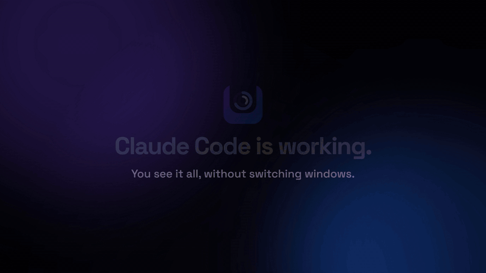
</p>

<p align="center"><a href="https://github.com/Yovancas/muesca/releases/latest/download/muesca-en-16x9.mp4"><strong>▶ Watch the 35-second video</strong></a></p>

<p align="center"><sub><strong>Not affiliated with Anthropic. Claude is a trademark of Anthropic.</strong> Muesca only reads the quota
your own Claude Code session already has.</sub></p>

## Why Muesca

- **Know where you stand, at a glance.** Two rings at the top of the screen: your real 5-hour and 7-day quota, the same
  figures Claude Code respects. No more hitting the limit by surprise.
- **Answer Claude without leaving what you're doing.** When Claude Code needs a permission, the notch shows it with
  **Allow / Deny**. When it finishes, it tells you.
- **All your sessions in one place.** Who's working, who's waiting for you, and one click to jump to its terminal.
- **Light and private.** ~0 % CPU at rest, no account, nothing about you leaves your machine.

## Get started in 1 minute

1. **Download** the installer from the [latest release](https://github.com/Yovancas/muesca/releases/latest) and run it
   (per-user, no admin, no .NET needed).
2. The notch drops from the top of your screen with a **short welcome**: pick a profile and what to turn on.
3. Open **Claude Code** as usual. The notch fills in by itself. Want the full tour? *Tray menu › Tutorial*.

<details>
<summary><strong>Contents</strong></summary>

- [What is Muesca?](#what-is-muesca)
- [Features](#features)
- [How the data works](#how-the-data-works) · [Privacy & data](#privacy--data)
- [Install](#install) · [Requirements](#requirements) · [Configuration](#configuration)
- [Live sessions & hooks](#live-sessions--hooks)
- [Uninstall](#uninstall) · [Notes & FAQ](#notes--faq)

</details>

> **Muesca is the new name of ClaudeBar for Windows.** Same app, same settings: your config, tasks, history and Claude
> Code hooks stay where they were and you don't have to do anything. Why: «Claude» is Anthropic's trademark, so the
> product can't be called that. Details in [docs/branding.md](docs/branding.md).

---

## What is Muesca?

A black notch hangs from the top edge of your screen, like the one on a phone. At rest it shows two rings: your
**5-hour** and **7-day** Claude quota, the **real percentages** Anthropic returns to Claude Code itself. Hover over it
and it opens: your quota with its reset time and, next to it, **every open Claude Code session** and what it's doing.
When Claude needs you (a permission, your turn to type, a finished task, a quota about to run out) the notch tells you,
and you can **allow or deny a permission without going to the terminal**.

Swipe the wheel and the notch has more pages: **music with synced lyrics**, **tasks with reminders**, a **file shelf**,
**usage charts** and a **pomodoro**. Next to the clock, the **tray icon** keeps the classic panel: quota bars, pace,
estimated spend per model and history.

Two numbers, two truths, and Muesca is honest about which is which:

- **Quota % (5h / 7d) is REAL**: the exact figure Anthropic returns to Claude Code.
- **The $ spend is an ESTIMATE**: an API-equivalent cost computed locally from your transcripts. It is **not** your
  subscription bill.

It's **C# / .NET 9 + WinForms**, everything drawn with GDI+ (crisp at any DPI), and it costs **~0 % CPU at rest**.

---

## Features

<sub>Screenshots use the sample data of the built-in tutorial: never anyone's real quota.</sub>

### The notch

<p align="center">
  
  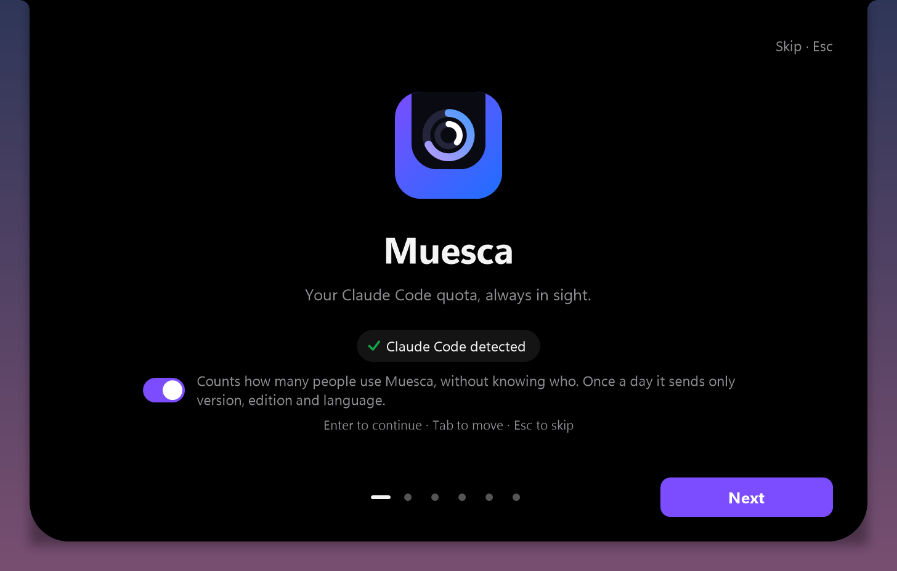
</p>

- **At rest, two rings**: the 5h and 7d quota. Hover and it opens (or only with a click, if you prefer).
- **Faces for every moment**: *working* (spinner, project, tool and your %), *done* (a green notice and an optional
  chime), *high quota* (a warning at 80 %, red with a glow at 95 %), a **minimal** thin line, or the **clock with a cat**
  whose eyes follow your pointer when things are calm.
- **Out of your way**: it hides in full-screen games and video, never steals focus, and respects *Reduce motion*.
- **Pages**: the wheel, the dots or the ‹ › arrows move between Claude, Usage, Music, Tasks, Focus and Shelf.
- **Welcome inside the notch**: the first time, the notch drops and unfolds into a short setup (profiles with a live
  preview, what to turn on, recommended settings, Claude Code) that you can redo from the tray.

### Sessions

- On the right of the open notch, **every open Claude Code session**: project, what it's doing and since when.
- **Working · your turn · idle**: spinning while Claude works, *your turn* when it waits for you to type.
- **A click on a session brings its terminal to the front.**
- Opt-in: it installs hooks in `~/.claude/settings.json` with a backup first (see [Live sessions & hooks](#live-sessions--hooks)).

### Permissions <sub>Pro</sub>

<p align="center">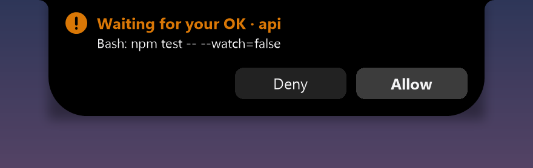</p>

- When Claude Code asks for permission (run a command, edit a file…), the notch shows it with **Deny / Allow**.
- The buttons **arm first** (they fill up and don't respond until then), so you never approve something you haven't
  read.
- **Nothing is decided without your click**: if Muesca is closed, busy or you don't answer within 25 s, Claude Code asks
  in its terminal as always.

### Music and lyrics <sub>Pro</sub>

<p align="center">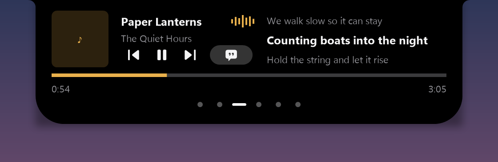</p>

- Whatever plays in Windows (Spotify, the browser…) with its cover: play/pause, previous/next, seek.
- **Synced lyrics** line by line (from [lrclib.net](https://lrclib.net)), and the current line in the closed notch.

### Tasks and reminders <sub>Pro</sub>

<p align="center">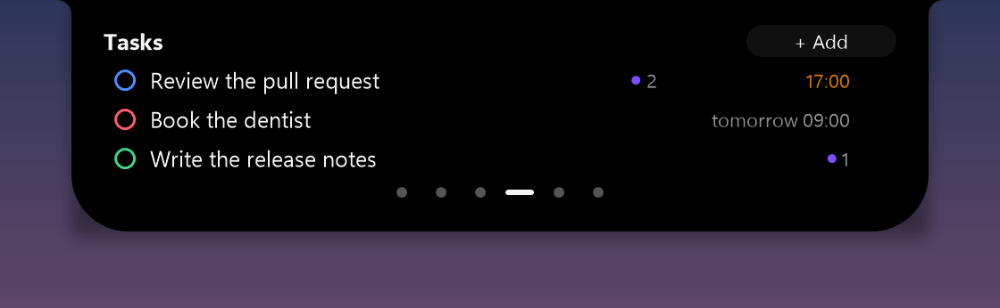</p>

- A short list in the notch: title, color and when to remind you (15 min, 1 h, tomorrow at 9 or your own time).
- At its time, a notice with **Done** and **+10 min**.

### File shelf <sub>Pro</sub>

<p align="center">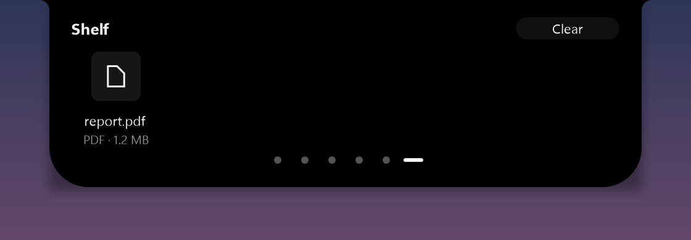</p>

- Drop a file, a link or text onto the notch and it stays on the shelf. Click to open it, drag it out to drop it into
  another app.

### Usage

<p align="center">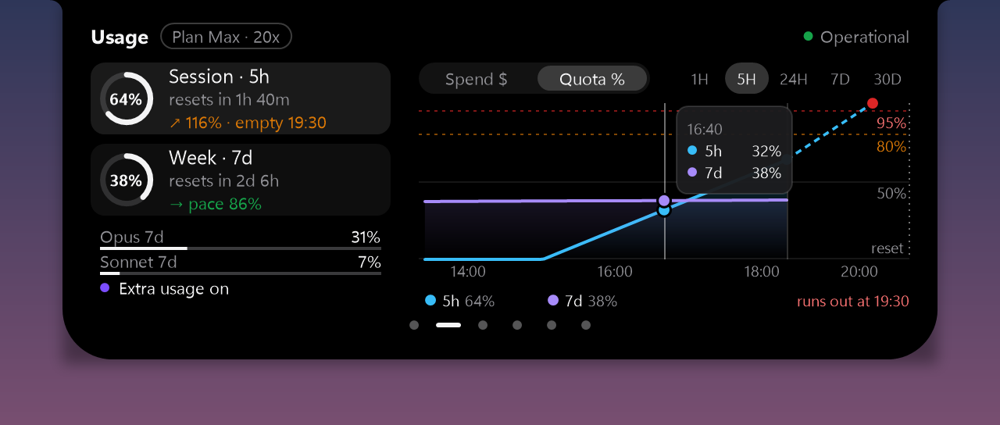</p>

- Today's spend, your quota and your pace, with a chart of **spend per model** or **quota %**.
- Click the 5h or 7d card and the chart shows that window. With Pro: tooltips, ranges from 1H to 30D and where your
  pace is heading.

### Focus (pomodoro)

<p align="center">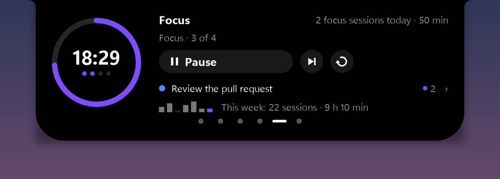</p>

- 25 min of focus, then a break (a long one every 4). Start, pause, skip, restart.
- Closed, a **mini ring** shows what's left. At the end of a phase, a notice offers the next one.
- With Pro: link the focus to a task and see your week.

### The tutorial

<p align="center">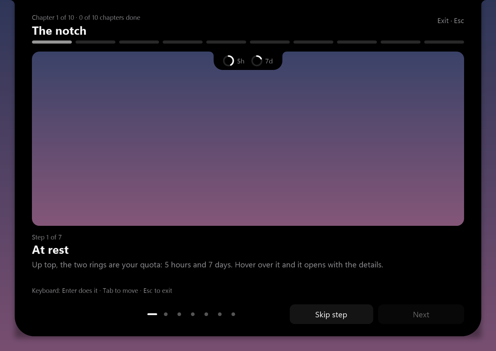</p>

- Ten short chapters with a **demo notch** you use for real: hover, click, drag. Sample data only; nothing is sent to
  Claude. Open it at the end of the welcome, from the tray menu or from *Settings › About*.

### Tray icon and panel

<p align="center">
  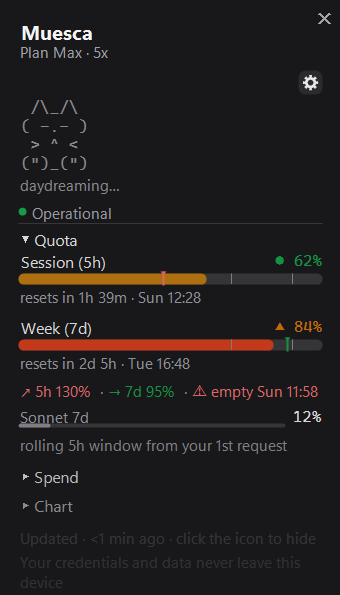
  
</p>

- **The badge by the clock** shows the higher of your two windows, shading green → amber → red, with colorblind-safe
  shapes (**triangle** = warn, **diamond** = critical), auto-contrast text and an amber dot when a session needs you.
- **The panel** (click the icon): 5h and 7d bars by real %, **pace with a per-window run-out estimate**, estimated
  **spend per model** (every family that shows up in your data, priced from [models.dev](https://models.dev)), a chart of
  spend or quota from 1H to 30D, service health and the live-session cat.
- **Notifications**: milestones (25 / 50 / 75 / 95 %), pace alerts and live-session notices.
- **Themes** System / Dark / Light / CLI (plus `.itermcolors` import), adjustable opacity, pinned, always on top.
- **8 languages**: English, Español, Nederlands, Français, Deutsch, 日本語, 한국어, 繁體中文.

### Free and Pro

| | Free | Pro |
|---|:---:|:---:|
| Tray icon, panel, charts, notifications, themes, languages | ✓ | ✓ |
| Notch: quota rings, quota notices, session states, Usage, Focus, tutorial | ✓ (main monitor) | ✓ |
| Allow / Deny from the notch | | ✓ |
| Music and synced lyrics | | ✓ |
| Tasks with reminders | | ✓ |
| File shelf | | ✓ |
| Notch on every monitor | | ✓ |
| Usage charts (tooltips, ranges, projection) and advanced pomodoro | | ✓ |

- **Pro is a one-time payment**, sold in the **Microsoft Store** edition (with a **7-day trial**). The GitHub / winget
  edition is free and shows Pro features with a discreet *Pro* chip and a button to the Store.
- Without Pro nothing breaks: tasks and shelf keep their data, and permission requests go to Claude Code's own dialog.

---

## How the data works

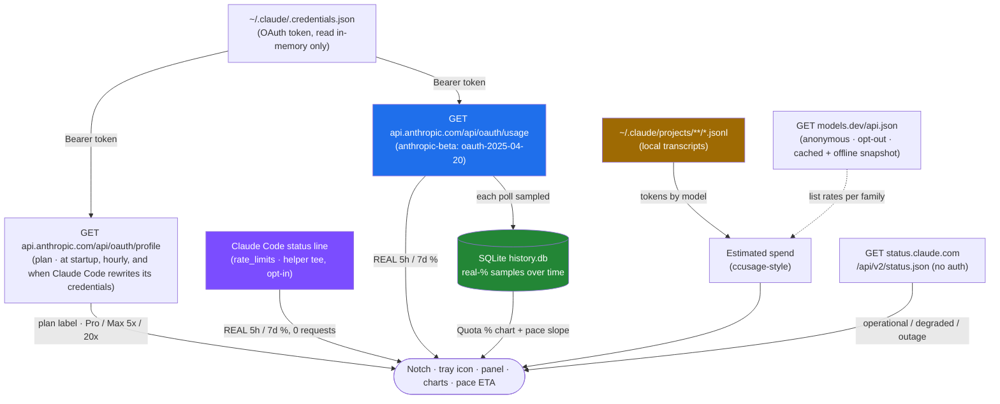

1. **Quota from Claude Code, zero API requests (opt-in).** Claude Code already hands its status line your `five_hour` /
   `seven_day` usage (Pro/Max, Claude Code ≥ 2.1.80). With **Settings → Quota source → Read quota from Claude Code**,
   Muesca puts a tiny native tee (`claudebar-helper.exe`) in front of your status line in `~/.claude/settings.json`:

   ```
   <helper> statusline --tee | ccstatusline      # your status line keeps getting the same JSON
   ```

   It is written so that it survives the helper going away: if `<helper>` is missing (say, Muesca was uninstalled
   without turning this off), your status line gets the JSON directly and keeps working. In Git Bash it reads
   `if [ -e <helper> ]; then <helper> statusline --tee; else cat; fi | ccstatusline`; in PowerShell, the same with
   `Test-Path`.

   The helper saves one small snapshot per session under `%LOCALAPPDATA%\ClaudeBarWin\ratelimits\` and Muesca picks it
   up within a second of each Claude reply. No status line yet? Muesca adds a compact `5h 23% | 7d 41%`. Turning it off
   restores your status line **exactly**; `settings.json` is always backed up first. Compound status lines (`a && b`,
   `a; b`) are left alone.
2. **Quota from the API (on by default, unofficial).** With **Read quota with your Claude Code session (unofficial)**
   on, `GET https://api.anthropic.com/api/oauth/usage` with your local OAuth token (see [Privacy & data](#privacy--data))
   returns `five_hour` / `seven_day` (plus Opus / Sonnet) with `utilization` and `resets_at`, the **same limits Claude
   Code respects**. While a session feeds the status line, the API is asked at most every 15 minutes. On `429` it backs
   off (5 → 10 → 20 … ≤ 60 min, honouring `Retry-After`) and serves the last good value.
3. **Real-% history.** Each reading is sampled into SQLite (`%APPDATA%\ClaudeBarWin\history.db`, at most once a minute,
   pruned after 40 days). It feeds the *Quota %* chart and the pace estimate, so it **starts empty and fills in**.
4. **Pace + ETA.** Pace = used % vs the ideal for how much of the window has elapsed. The ETA extrapolates from the
   recent slope, ignoring resets.
5. **Expired token: never rewritten by Muesca.** Muesca **never writes** `~/.claude/.credentials.json`: Claude Code
   keeps it fresh and Muesca reads it again when it changes. Only if you turn on **Force renewal with the CLI (uses one
   message)**, off by default, does it run `claude -p .` (at most once every 30 minutes).
6. **Service health.** `GET status.claude.com/api/v2/status.json` (public, no auth), cached ~2 min.
7. **Estimated spend.** Your local `.jsonl` transcripts (the `ccusage` method) priced with **list prices from
   [models.dev](https://models.dev)**: cached in `%APPDATA%\ClaudeBarWin\models-pricing.json`, with an **embedded
   offline snapshot**, and the optional **Update rates online** toggle is the only thing that touches models.dev (an
   anonymous GET). A model with no known price shows `— no rate` and is left out of the total. It's an
   **API-equivalent estimate, not your bill**.

### Privacy & data

- **What it reads.** From `~/.claude/.credentials.json`, only `claudeAiOauth.accessToken` and `expiresAt` (plus the
  non-secret `subscriptionType` / `rateLimitTier` as a plan fallback), right before each request. The `refreshToken` is
  never read, and the bytes are zeroed afterwards.
- **Where it goes.** Only to `https://api.anthropic.com/api/oauth/usage` and `/api/oauth/profile`: HTTPS on port 443,
  host checked before sending and on the response, **redirects never followed**, a 10 s timeout, a 64 KB response cap,
  your system proxy and an honest `ClaudeBarWin/<version>` User-Agent (it never pretends to be Claude Code).
- **What it stores.** Nothing: the token lives in memory for one request, is never written to config, caches, logs or
  dumps, and prints as `Creds(***)`.
- **The plaintext file is Claude Code's.** Muesca doesn't, can't and mustn't encrypt it (Claude Code could no longer
  read it), and never writes or copies it.
- **Unofficial.** Anthropic doesn't document these endpoints for third parties, so they may change without notice.
- **With the setting off** Muesca never opens `.credentials.json` or calls those endpoints: the quota comes only from
  the status line.
- **Anonymous usage count** (on by default, one switch to turn off): at most once a day, exactly
  `{"v":"1.0.0","e":"free","l":"es","d":1,"m":1,"n":0}` (version, edition, language and three 0/1 boxes). **No ID of
  any kind**; the server only adds up boxes per day, stores no IPs and keeps no logs. Turn it off in **Settings ›
  System**, in the welcome, or with `CLAUDEBAR_NO_STATS=1`. Details: [PRIVACY.md](PRIVACY.md).
- **Nothing about you leaves your machine**: no credentials, transcripts, prompts or usage numbers. The only outbound
  calls are the ones listed here, plus lyrics from lrclib.net when the music page looks them up.

Security policy and threat model: [SECURITY.md](SECURITY.md).

---

## Install

### Download the installer (recommended)

Download the installer (`ClaudeBar-win-Setup.exe`, Velopack names it after the internal package id) from the
**[latest release](https://github.com/Yovancas/muesca/releases/latest)** and run it.

- **Per-user, no admin**, **self-contained (no .NET needed)**, installed in 2-3 s with a splash screen. *Muesca* appears
  in the Start menu and in *Apps*.
- **Updates install themselves**: downloaded in the background with delta patches and applied when you restart Muesca
  from the tray menu (or when it closes). Every release carries an **Ed25519-signed manifest**; anything not signed with
  Muesca's key is ignored.
- Coming from **ClaudeBar 0.3.9 / 0.4.0**? Its own updater moves you to Muesca on its own, keeping your config and
  hooks.
- On **Windows 11** a new tray icon hides in the `^` overflow: drag it onto the taskbar to pin it.

> **SmartScreen** may warn because the `.exe` isn't Authenticode-signed → **More info → Run anyway**.

---

## Requirements

- **Windows 10 (1809+) / 11, x64**.
- **Claude Code** (CLI or app) installed and signed in: Muesca reads your local quota, sessions and transcripts.
  Without it there's no quota to show.

---

## Configuration

All settings live on one grouped screen (the **⚙** in the panel, or *Settings* in the tray menu). The tray menu also has
*Notch monitor* and *Set up again…* (to redo the welcome).

| Group | What's in it |
|---|---|
| **Notch** | Enabled · Monitor (main, a fixed one, following the active window, all) · Size · Open with (hover or click) · Minimal mode when idle |
| **Panel content** | Estimated spend · Service status · Usage chart |
| **Quota source** | Read quota from Claude Code (status line) · **Read quota with your Claude Code session (unofficial)** → Force renewal with the CLI (uses one message), off |
| **Live sessions** | *master* Enabled (installs/removes Claude Code hooks) → Show mascot · Mute when terminal focused |
| **Notifications** | *master* Enabled → Pace alerts · Milestones 25 / 50 / 75 / 95 |
| **Update frequency** | 30s · 1min · 5min · 15min |
| **Icon** | Mode `%` / `▲` / `%▲` · Color threshold 70/90 · 80/95 · 60/85 |
| **Appearance** | Theme System/Dark/Light/CLI · Position · Opacity · Pinned · Always on top · Reduce motion |
| **System** | Start with Windows · Update rates online · Anonymous usage count · Language |
| **About** | Version · Tutorial · Import `.itermcolors…` · what Muesca is and the trademark notice |

Settings persist to `%APPDATA%\ClaudeBarWin\config.json` (the folder keeps its old name on purpose: see
[docs/branding.md](docs/branding.md)).

---

## Live sessions & hooks

> **Opt-in and off by default.** Together with *Quota source* and permissions from the notch, it's the only thing that
> touches your Claude Code config, so it asks first.

Claude Code fires a hook → the tiny native `claudebar-helper.exe hook` reads the event → forwards it over a local named
pipe → Muesca updates the notch, the cat and the session list. **Fire-and-forget**: if Muesca isn't open or the pipe
doesn't answer in 100 ms, the hook exits silently and **never blocks your session**.

- **Confirmation first**, with the default button on **No**.
- **Timestamped backup** before any write: `settings.json.claudebar-bak-YYYYMMDD-HHmmss`.
- **Idempotent merge**: it tags its own entries by executable name, never duplicates them and **never touches your other
  hooks**.
- **Permissions from the notch** add a `PermissionRequest` entry (`claudebar-helper permission`, timeout 45 s). Without
  your click (or without Pro), the helper gives no answer and Claude Code shows its own dialog.
- **Clean uninstall**: removes only Muesca's entries and restores your status line.

The internal names (`claudebar-helper`, the `claudebar` pipe, the `ClaudeBarWin` folders) don't change with the new
name, so your existing hooks keep working.

---

## Uninstall

- *Settings › Apps › Muesca › Uninstall*. It removes Muesca's hooks, restores your status line if *Quota source* was on,
  and deletes the helper.
- **Your data survives by design**: config and history live in `%APPDATA%\ClaudeBarWin\`. Delete that folder to purge
  everything.

---

## Notes & FAQ

- **Does Muesca use my Claude messages?** No. It reads your quota and sessions; it never sends a prompt (unless you turn
  on *Force renewal with the CLI*, off by default, which says so in its name).
- **Is it safe to let it answer permissions?** It never decides for you: the buttons arm before they respond, and without
  your click Claude Code asks in its own terminal as always. The security model is in [SECURITY.md](SECURITY.md).
- **Mac?** Muesca is Windows-only. On macOS, look at [ClaudeBar](https://github.com/tddworks/ClaudeBar), which inspired it.
- **Why "Muesca"?** It's Spanish for *notch*. «Claude» is Anthropic's trademark and Muesca isn't Anthropic's, so the old
  name had to go. See [docs/branding.md](docs/branding.md).
- **Real vs estimated**: the **5h / 7d %** is real (Anthropic's own figure); the **$ spend** is a local API-equivalent
  estimate.
- **"Stale" / dimmed icon**: the data is older than 3× your refresh interval (offline, a 429 cooldown…). The icon dims
  and the tooltip says so rather than showing an old number as live.
- **SmartScreen** on first run is expected (the `.exe` isn't Authenticode-signed).

---

## Credits

Muesca started as a Windows take on [ClaudeBar](https://github.com/tddworks/ClaudeBar) (macOS), with data ideas from
[CodeZeno/Claude-Code-Usage-Monitor](https://github.com/CodeZeno/Claude-Code-Usage-Monitor) and
[ccstatusline](https://github.com/sirmalloc/ccstatusline), and UI cues from [CodexBar](https://github.com/steipete/CodexBar).

Lyrics from [lrclib.net](https://lrclib.net). Lyrics icon: ["Apple Music Lyrics"](https://icons8.com/icons/set/apple-music-lyrics)
by [Icons8](https://icons8.com) (see [THIRD-PARTY-NOTICES.md](THIRD-PARTY-NOTICES.md)).

**Muesca is made by Bekay. Not affiliated with Anthropic. Claude is a trademark of Anthropic.**

## License

Muesca is **free to use** and **proprietary** since 1.0: see [LICENSE](LICENSE). Pro is unlocked with a
purchase in the Microsoft Store. The source code of Muesca 1.0 and later is private.

The versions of *ClaudeBar for Windows* up to **0.3.9** were open source under the MIT License and remain so at
[Yovancas/claudebar-win](https://github.com/Yovancas/claudebar-win). The anonymous usage counter's server code is
public, for transparency, in [server/stats-worker](server/stats-worker).
